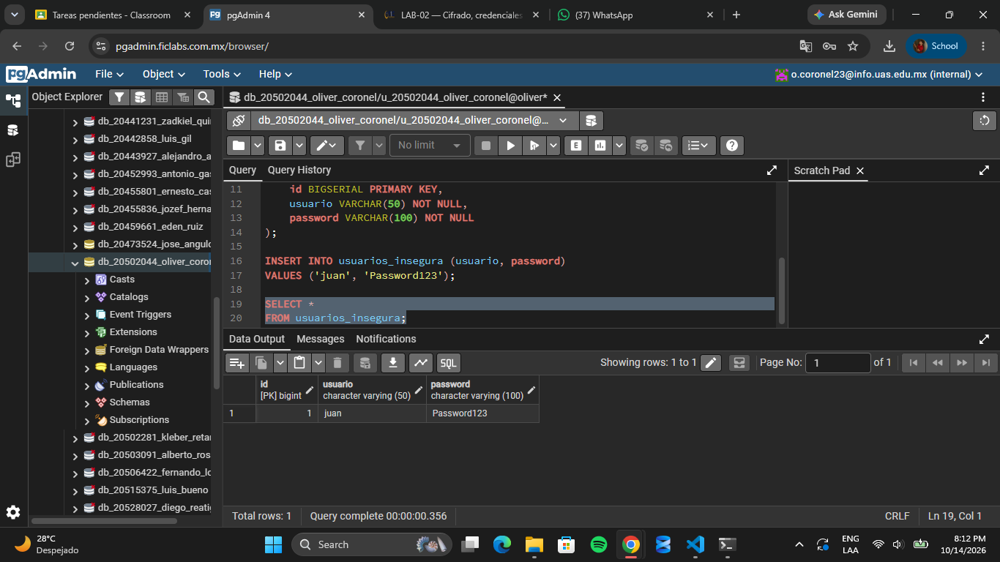

# Evidencia 01

¿Qué ocurriría si una persona obtiene acceso de lectura a esta tabla?

Si una persona obtiene acceso de lectura a la tabla usuarios_insegura, podrá ver los nombres de usuario y las contraseñas almacenadas en texto plano, como Password123. Esto representa un riesgo de seguridad, ya que podría utilizar esas credenciales para acceder a las cuentas de los usuarios o a otros servicios si reutilizan la misma contraseña.

Por esta razón, las contraseñas nunca deben almacenarse en texto plano. Se deben guardar utilizando funciones de hash diseñadas para contraseñas, como Argon2id, bcrypt o scrypt.

