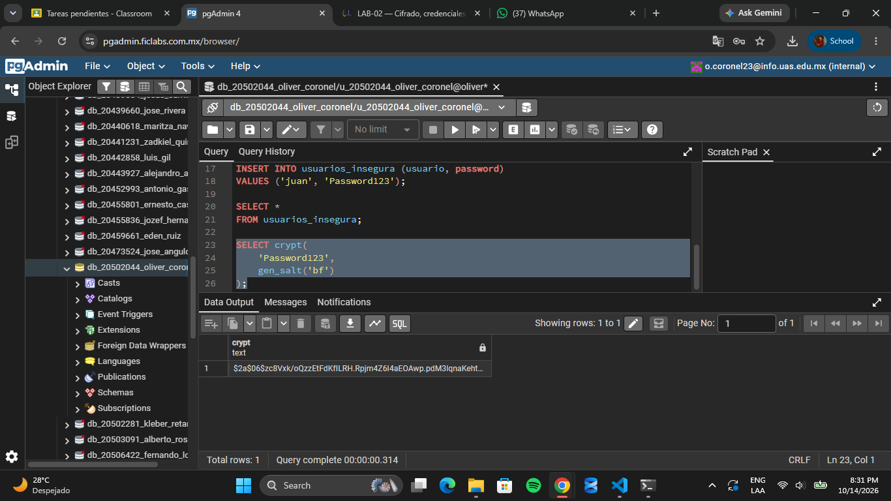
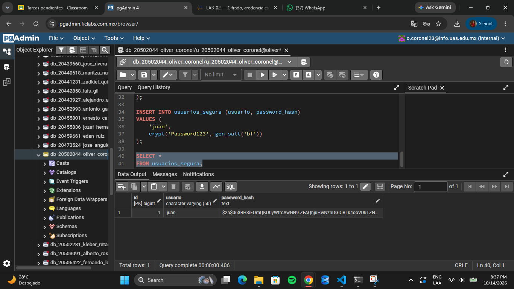

# Evidencia 2
## 7.3 Preguntas
¿Son iguales? No, los resultados son diferentes, aunque se utilice la misma contraseña.

Si no son iguales, ¿por qué? Porque gen_salt() genera una sal aleatoria cada vez que se ejecuta. Esto hace que la misma contraseña produzca hashes diferentes, aumentando la seguridad.

¿Qué función cumple gen_salt()? La función gen_salt() genera una sal aleatoria que se utiliza junto con la contraseña para calcular el hash. En este caso, gen_salt('bf') utiliza el algoritmo Blowfish, conocido como bcrypt.

¿Qué función cumple crypt()? La función crypt() genera un hash de la contraseña utilizando el algoritmo y la sal proporcionados. Se utiliza para almacenar contraseñas de forma más segura y posteriormente verificar si una contraseña ingresada coincide con la original.

¿Esto es cifrado reversible? No, no es cifrado reversible. Es un proceso de hash, que transforma la contraseña en un resultado que no puede convertirse directamente de nuevo en la contraseña original. Para comprobar una contraseña, se utiliza el hash almacenado y se verifica si coincide con el resultado esperado.

## No aparece contraseña original

## Verificacion de contraseña

## Verficacion con contraseña incorrecta

## 7.5 Preguntas
¿Qué resultado obtuviste con la contraseña correcta? Tue

¿Qué resultado obtuviste con la contraseña incorrecta? False

¿Por qué no es necesario recuperar la contraseña original? Porque el sistema puede comprobar si la contraseña ingresada es correcta comparándola con el hash almacenado. De esta manera, no necesita conocer ni recuperar la contraseña original.

¿Por qué un hash no debe confundirse con cifrado? Un hash es una transformación unidireccional que no está diseñada para recuperar el dato original. En cambio, el cifrado permite recuperar la información original mediante una clave de descifrado. Por eso, las contraseñas deben almacenarse mediante funciones de hash seguras y no mediante cifrado reversible.
