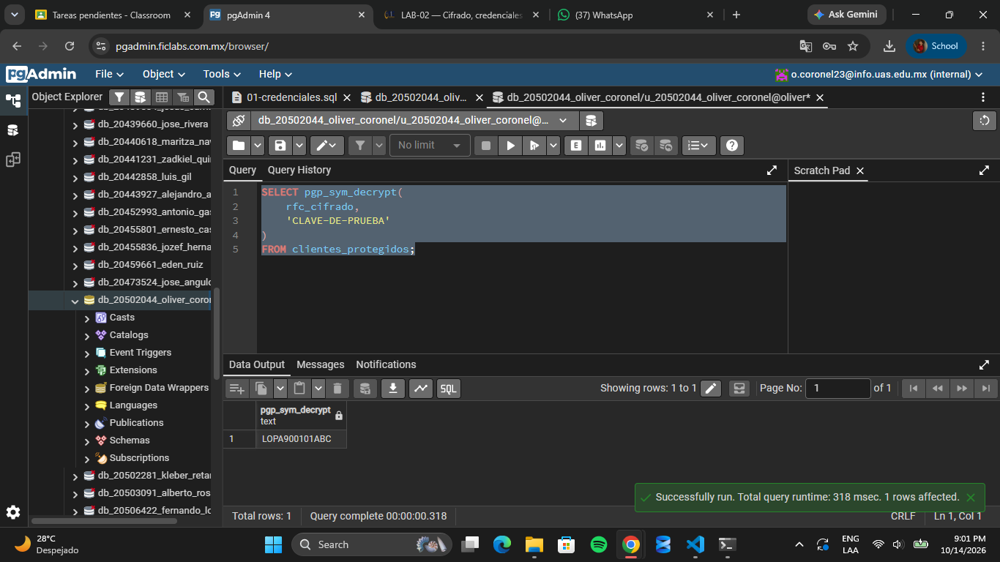

# Evidencia 3
## Pregunta 9.1
¿Qué ocurriría si esta clave fuera una clave utilizada realmente por una organización y el archivo se publicara en un repositorio Git? Si la clave real de una organización se publicara en un repositorio Git, una persona con acceso al repositorio podría obtenerla y utilizarla para descifrar la información protegida con esa clave. Esto podría provocar la exposición de datos confidenciales, como RFC de clientes, y representar un riesgo de seguridad y privacidad.
Aunque se elimine la clave del archivo, podría seguir disponible en el historial de Git. Por eso, la organización debería cambiar o revocar la clave comprometida, evaluar qué información pudo quedar expuesta y almacenar las claves de forma segura mediante variables de entorno o un gestor de secretos.

## 10. Actividad 4
¿Qué sucede con la información mientras viaja entre el cliente y PostgreSQL? La información viaja entre el cliente y PostgreSQL a través de la red. Si la conexión no utiliza SSL/TLS, los datos y las consultas podrían transmitirse sin cifrado, permitiendo que alguien que intercepte la comunicación pueda leerlos. Si se utiliza SSL/TLS correctamente configurado, la información viaja cifrada y se protege contra la interceptación.