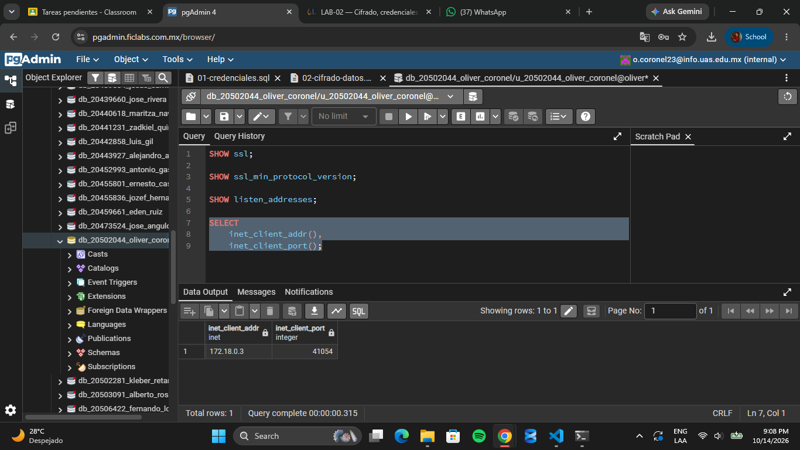
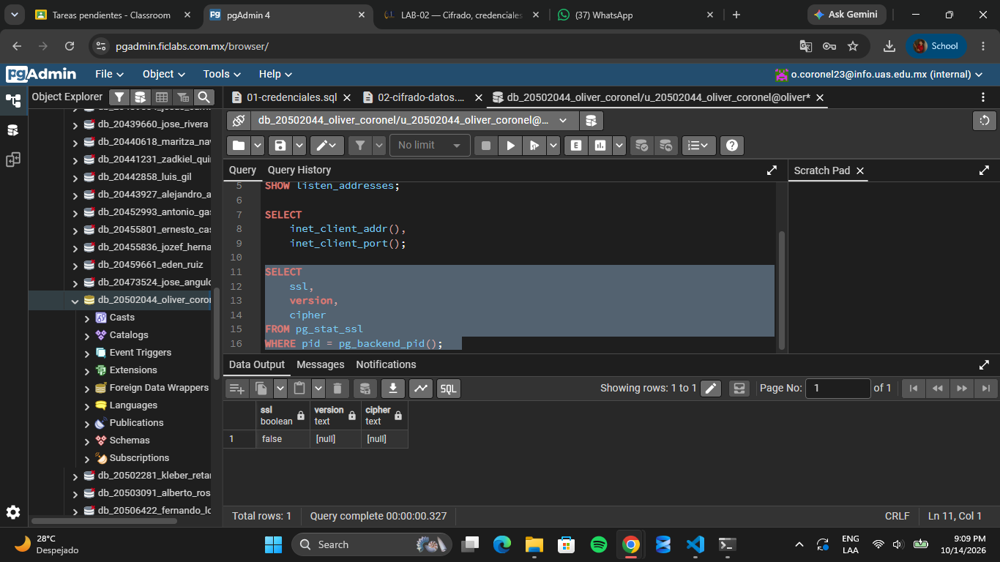

# Evidencia 4

## Conexion actual

## Ahora verifica si la sesión actual utiliza TLS

## 11.1 Preguntas 
¿La conexión actual utiliza TLS? No. El resultado de la consulta muestra false en la columna ssl, lo que indica que la conexión actual no utiliza TLS.

¿Qué versión de TLS se está utilizando? No se está utilizando ninguna versión de TLS, ya que la conexión no está cifrada mediante este protocolo. Por eso, la columna version muestra NULL.

¿Qué algoritmo de cifrado aparece? No aparece ningún algoritmo de cifrado. La columna cipher muestra NULL porque la conexión actual no utiliza TLS.

¿Qué diferencia existe entre una conexión protegida con TLS y una conexión sin TLS? Una conexión protegida con TLS cifra la información que viaja entre el cliente y PostgreSQL, ayudando a evitar que terceros puedan leerla si interceptan la comunicación. En cambio, una conexión sin TLS no cuenta con esa protección, por lo que los datos transmitidos pueden quedar expuestos a la interceptación.

### Se intentó establecer una conexión desde la terminal CT101 utilizando psql y el parámetro sslmode=require. Sin embargo, la conexión no pudo completarse porque la terminal no logró resolver el nombre del servidor y, al utilizar la dirección IP 172.18.0.4, se produjo un tiempo de espera agotado (timeout). Posteriormente, se verificó la sesión actual desde pgAdmin mediante la consulta a pg_stat_ssl. Los resultados fueron ssl = false, version = NULL y cipher = NULL. Esto indica que la sesión actual no utiliza TLS. No obstante, no se pudo comprobar si una conexión nueva con sslmode=require funcionaría, debido a que la terminal no logró alcanzar el servidor.