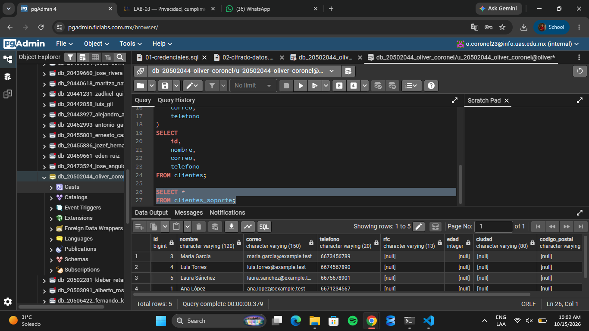

# Evidencia 1
| **Campo** | **¿Es dato personal?** | **Finalidad** | **¿Es necesario?** | **Nivel de acceso** | **Retención** |
|---|---|---|---|---|---|
| id | Sí, si identifica a una persona | Identificar el registro | Sí | Interno | Mientras exista el registro |
| nombre | Sí | Identificar a la persona | Sí | Restringido | Mientras sea necesario |
| correo | Sí | Contactar a la persona | Sí | Restringido | Mientras esté activo el registro |
| telefono | Sí | Contactar a la persona | Depende del uso | Restringido | Mientras sea necesario |
| rfc | Sí | Identificación fiscal | Solo si se requiere | Muy restringido | Según obligaciones legales |
| edad | Sí, si se relaciona con una persona | Estadísticas o validación de edad | Depende del uso | Restringido | Mientras sea necesario |
| ciudad | Sí, si se relaciona con una persona | Conocer la ubicación general | Depende del uso | Interno | Mientras sea necesario |
| codigo_postal | Sí, si se relaciona con una persona | Ubicación geográfica | Depende del uso | Restringido | Mientras sea necesario |
| fecha_alta | Puede serlo si se relaciona con una persona | Registrar cuándo se creó el registro | Sí | Interno | Mientras exista el registro |

#### Preguntas

**1. ¿Todos los campos son necesarios para atención al cliente?**

No, solo son necesarios los campos que se utilizan para identificar al cliente y resolver sus solicitudes.

**2. ¿Por qué soporte necesitaría conocer el RFC?**

Generalmente no lo necesita, excepto cuando debe atender trámites fiscales o verificar información relacionada con facturación.

**3. ¿Necesita conocer la edad?**

No necesariamente, solo cuando sea importante para el servicio o para verificar algún requisito de edad.

**4. ¿Necesita conocer el código postal?**

Depende del servicio. Puede ser necesario para envíos o verificar una dirección, pero no para todas las solicitudes.

**5. ¿Qué principio de privacidad está relacionado con esta decisión?**

El principio de minimización de datos, que consiste en recopilar y utilizar únicamente la información personal necesaria para cumplir con una finalidad específica.

