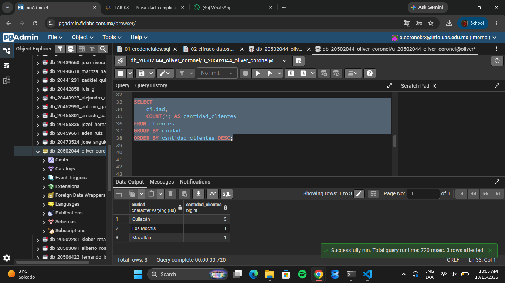
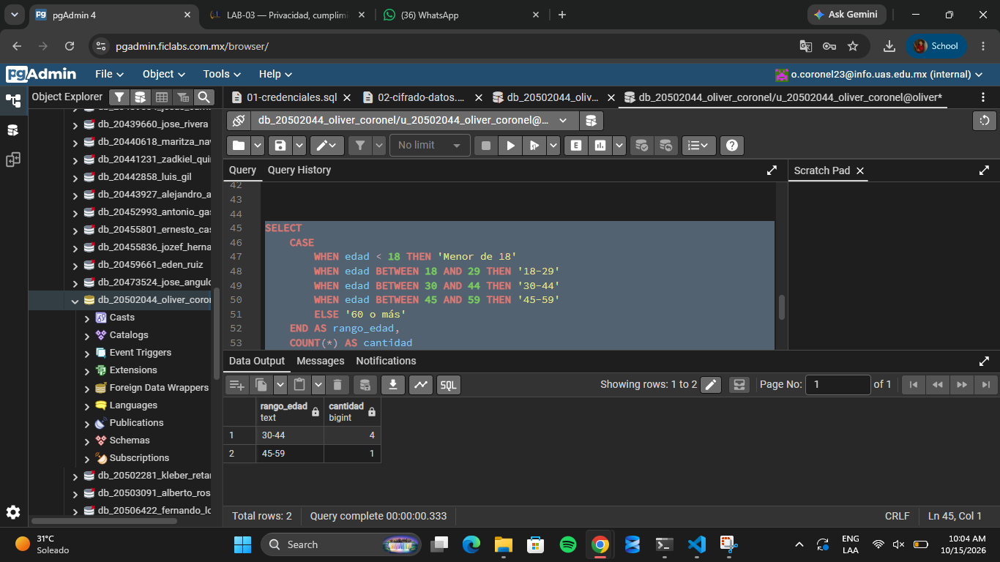
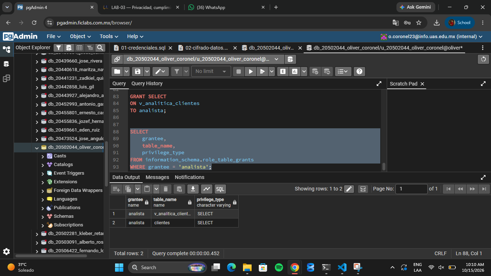

# Evidencia 5
## Diseña una consulta que proporcione información agregada

## Creación de rangos de edad

**Pregunta:** ¿Por qué esta información puede ser más apropiada para analítica que entregar directamente la tabla completa de clientes?

**Respuesta:** Porque permite obtener estadísticas sin exponer datos personales como nombres, correos, teléfonos o RFC. De esta manera, se protege la privacidad de los clientes y se aplica el principio de minimización de datos.

## Comprobar privilegios de analista al haberle otorgado privilegios

#### Preguntas

**1. ¿Qué información puede consultar el rol?**

Puede consultar información agregada, como la cantidad de clientes por ciudad y por rango de edad.

**2. ¿Puede consultar directamente `clientes`?**

No, si sus permisos están restringidos a una vista o consulta específica para analítica.

**3. ¿Puede obtener nombre, correo y RFC?**

No, porque esos datos personales no son necesarios para realizar sus estadísticas.

**4. ¿Qué principio de privacidad estás aplicando?**

El principio de minimización de datos, porque solo se utiliza la información necesaria para la finalidad establecida.

**5. ¿Qué principio de seguridad estás aplicando?**

El principio de mínimo privilegio, porque el rol solo debe tener los permisos necesarios para realizar su trabajo.

## Analizar finalidad secundaria
#### 1. ¿El hecho de que la organización ya tenga los datos significa automáticamente que puede utilizarlos para cualquier finalidad?

No, los datos deben utilizarse para una finalidad legítima y compatible con la que se informó al cliente. Antes de usarlos para promociones, se debe revisar si ese uso está permitido y si se requiere consentimiento.

#### 2. ¿Qué preguntas debería realizar la organización antes de implementar este tratamiento?

Debería preguntar si los clientes fueron informados sobre el uso de sus datos para publicidad, si es necesario obtener su consentimiento, qué datos se necesitan y cómo se protegerá su privacidad.

#### 3. ¿Qué datos serían realmente necesarios?

La edad o rango de edad, la ciudad y cierta información del comportamiento de compra, siempre que sean necesarios para personalizar las promociones. No sería necesario utilizar directamente el nombre, correo, teléfono o RFC si se pueden realizar los análisis sin ellos.

#### 4. ¿Necesitaría el área de marketing acceso directo a `clientes`?

No necesariamente. Marketing podría trabajar con información limitada o con una vista que contenga únicamente los datos necesarios para crear las promociones, sin acceder a toda la información personal de los clientes.

#### 5. ¿Qué controles técnicos podrían limitar la información entregada?

Se podrían utilizar vistas de SQL, permisos por roles, consultas con datos agregados, seudonimización y controles de acceso. También sería conveniente registrar las consultas realizadas y revisar periódicamente los permisos.

