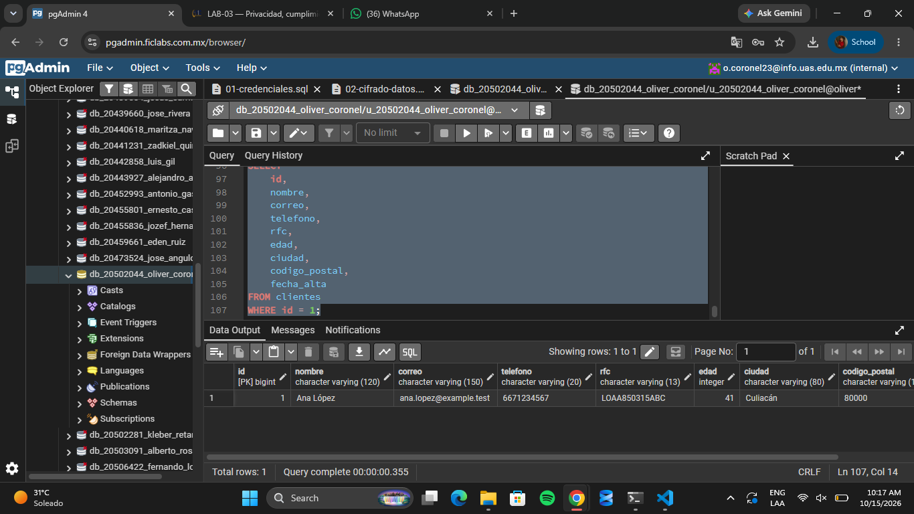
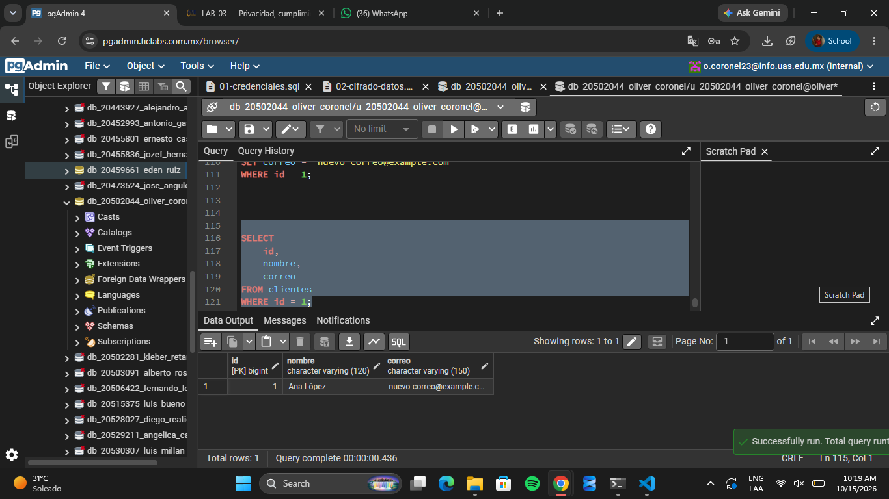

# Evidencia 8
## Derecho de acceso
### Consulta SQL

```sql
SELECT
    id,
    nombre,
    correo,
    telefono,
    rfc,
    edad,
    ciudad,
    codigo_postal,
    fecha_alta
FROM clientes
WHERE id = 1;
```



### Pregunta: ¿Qué información adicional debería proporcionar la organización además del resultado de esta consulta?

La organización debería explicar para qué utiliza los datos personales, de dónde los obtuvo, quién tiene acceso a ellos, cuánto tiempo los conserva y si los comparte con terceros. También debería indicar cómo solicitar una corrección o eliminación cuando corresponda.

Desde el punto de vista técnico, debe verificar la identidad del solicitante, comprobar que la consulta devuelva únicamente sus datos, evitar exponer información de otros clientes y entregar el resultado de forma segura.

## Derecho de rectificación

### Preguntas
**1. ¿Cómo podría comprobarse que el cambio fue autorizado?**

Verificando la identidad del cliente y comprobando que solicitó o autorizó la corrección de su correo electrónico.

**2. ¿Debería registrarse quién realizó el cambio?**

Sí, se debe registrar quién realizó el cambio, la fecha, la hora y qué dato fue modificado.

**3. ¿Por qué la trazabilidad será importante?**

Porque permite conocer el historial de los cambios, detectar modificaciones no autorizadas e identificar a los responsables en caso de algún problema.

##  Derecho de cancelación y ciclo de vida
**Pregunta: ¿Por qué eliminar un registro de una tabla no necesariamente significa que toda la información relacionada con esa persona haya desaparecido de la organización?**

Porque la información puede seguir almacenada en otros lugares, como respaldos, réplicas, reportes, archivos exportados y sistemas externos. Por eso, eliminar un registro de la tabla principal no garantiza que todas sus copias hayan desaparecido. Es necesario identificar dónde se encuentra la información y establecer un procedimiento para gestionar su eliminación en los sistemas correspondientes.